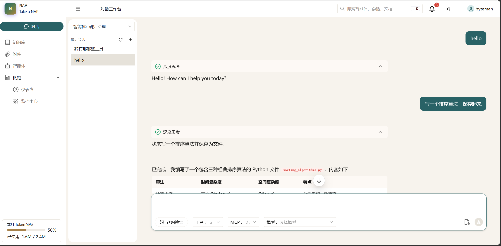
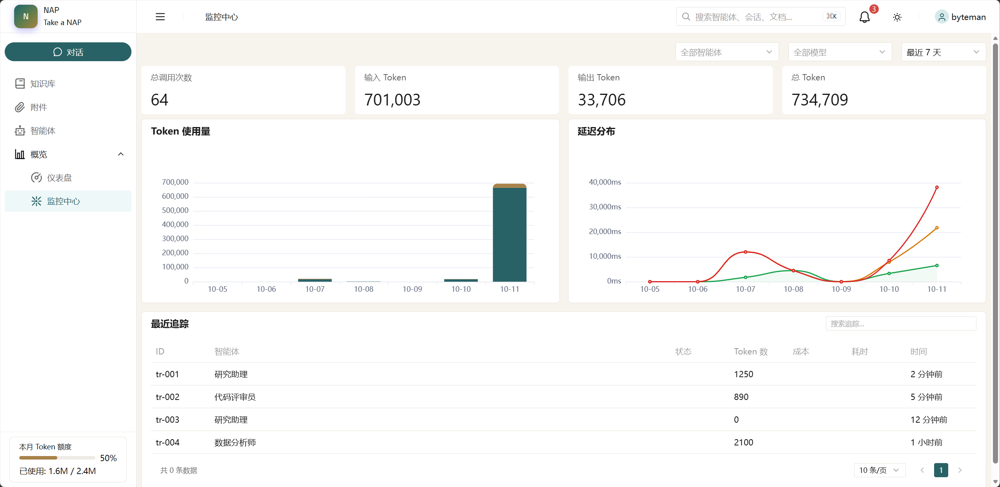
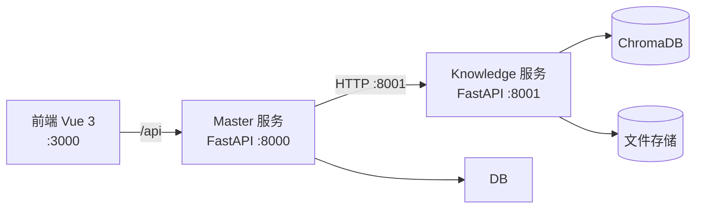

# NAP — Next-generation Agent Platform

> Hand it over and take a nap.

NAP 是一个轻量级的 AI 智能体与知识库融合平台：支持创建、配置多种智能体并与之对话，同时以知识库驱动检索增强，让每一次回答都有据可依。

| 预览 |  |
|------|------|
|  |  |


---

## 功能概览

| 模块 | 说明 |
|------|------|
| **仪表盘** | 运行状态总览、核心指标统计 |
| **智能体** | 创建 / 编辑 / 删除智能体，配置 LLM、工具、知识库与 MCP |
| **对话工作台** | 流式对话、思考过程可视化、会话管理、附件上下文 |
| **知识库** | 文档上传与 URL 抓取，向量化检索与处理进度 |
| **附件** | 文件上传管理，支持 md / txt / html 在线预览与下载 |
| **监控中心** | Token 用量、延迟分布、调用统计 |
| **设置** | LLM 提供商配置、MCP 服务管理 |

---

## 系统架构



- **Master**：面向前端的业务服务，负责用户、智能体、会话、附件、监控，并编排 Agent 对话。
- **Knowledge**：独立的向量化服务，负责文档解析、向量入库与检索召回。

---

## 技术栈

### 后端

| 技术 | 用途 |
|------|------|
| Python 3.13 + FastAPI | Web 框架，异步接口 |
| SQLModel + SQLite | ORM 与持久化 |
| pystonic | 应用脚手架（鉴权、日志、ORM、上下文） |
| ChromaDB + LangChain | 文档向量化与检索 |
| OpenAI Agents SDK | Agent 协议与工具调用 |
| LangGraph（checkpoint-sqlite） | 会话状态与持久化 |
| SSE（sse-starlette） | 流式响应推送 |
| markitdown | 文档 → Markdown 转换 |
| Loguru | 日志记录 |

### 前端

| 技术 | 用途 |
|------|------|
| Vue 3 + TypeScript | 响应式 UI |
| Vite | 构建与开发服务器 |
| TDesign Vue Next | 企业级组件库 |
| @tdesign-vue-next/chat | AI 对话组件（消息流、输入框） |
| Pinia | 状态管理 |
| Vue Router | 路由 |
| UnoCSS | 原子化 CSS |
| ECharts（vue-echarts） | 图表渲染 |
| markdown-it + highlight.js | Markdown 渲染与代码高亮 |

---

## 快速开始

### 方式一：一键脚本（推荐）

项目根目录提供了按服务启动的脚本，支持类 Unix 与 Windows：

```bash
./run-server.sh master       # 启动 Master 服务 (port 8000)
./run-server.sh knowledge    # 启动 Knowledge 服务 (port 8001)
./run-server.sh frontend     # 启动前端开发服务 (vite, port 3000)

./run-server.sh master --port 9000   # 支持追加参数
```

```bat
run-server.bat master
run-server.bat knowledge
run-server.bat frontend
```

> 首次运行前请先分别安装依赖（见下）。

### 方式二：手动启动

**后端**（需在 `nap-backend` 目录执行）：

```bash
cd nap-backend
uv sync                                            # 安装依赖

uv run uvicorn nap.master.asgi:APP --reload --port 8000       # Master
uv run uvicorn nap.knowledge.asgi:APP --reload --port 8001    # Knowledge
```

**前端**：

```bash
cd nap-frontend
npm install
npm run dev        # http://localhost:3000
```

前端开发服务器会把 `/api` 与 `/ws` 代理到 `localhost:8000`。

> Master 默认通过 `http://localhost:8001` 访问 Knowledge 服务，可在配置中调整。

### 服务端口

| 服务 | 端口 | 说明 |
|------|------|------|
| Master | 8000 | 业务 API，接口文档 `/api/docs` |
| Knowledge | 8001 | 向量化与检索 |
| Frontend | 3000 | 开发服务器 |

---

## 项目结构

```
next-agents-platform/
├── nap-backend/                    # 后端（uv 管理）
│   ├── nap/
│   │   ├── master/                 # Master 服务
│   │   │   ├── asgi.py             # ASGI 入口（鉴权 / 路由注册）
│   │   │   ├── manager.py          # 业务编排（智能体、知识、附件…）
│   │   │   ├── agent/              # Agent 运行时
│   │   │   │   └── tools/          # 工具集：builtin / web_search / mysql / mcp
│   │   │   └── api/v1/             # REST 接口模块
│   │   ├── knowledge/              # Knowledge 服务（独立 ASGI 应用）
│   │   │   ├── api/v1/             # documents / retrival / knowledge
│   │   │   └── graph/              # 文档处理流程
│   │   ├── services/               # 通用服务：convert / enrich / vector / storage
│   │   ├── db/                     # 数据模型与迁移
│   │   ├── llm/                    # LLM 驱动层
│   │   ├── common/                 # 配置、对象、客户端
│   │   └── cmd/                    # CLI 命令
│   └── pyproject.toml
├── nap-frontend/                   # 前端（Vite + Vue 3）
│   └── src/
│       ├── pages/                  # 页面组件
│       ├── components/             # 通用与布局组件
│       ├── stores/                 # Pinia 状态
│       ├── api/                    # 后端接口封装（axios）
│       ├── router/                 # 路由配置
│       └── styles/                 # 主题与全局样式
├── docs/                           # 文档与截图
├── run-server.sh                   # 服务启动脚本（类 Unix）
├── run-server.bat                  # 服务启动脚本（Windows）
└── README.md
```

---

## API 接口

基础路径：`/api/v1`，除注册与登录外均需携带 `Authorization: Bearer <token>`。

### Master 服务（:8000）

| 模块 | 路径 | 主要接口 |
|------|------|---------|
| 认证 | `/auth` | `login`、`token`（刷新） |
| 用户 | `/users` | 注册、`/me`、更新、删除 |
| 智能体 | `/agents` | CRUD、`/{uuid}/detail`、`/{uuid}/chat`（流式对话） |
| 会话 | `/sessions` | 列表、`/{id}/messages` 消息历史、删除 |
| 知识库 | `/knowledge-bases` | CRUD、`/{id}/stats`、`/{id}/knowledges` 关联文档、文件上传 |
| 文档 | `/knowledges` | 列表、详情、`/{uuid}/todos`、`/{uuid}/content`（原始内容）、删除 |
| 附件 | `/attachments` | 上传、列表、`/{uuid}`（元信息）、`/{uuid}/content`（原始内容）、删除 |
| 模型 | `/llms` | LLM 提供商 CRUD |
| MCP | `/mcps` | MCP 服务 CRUD |
| 工具 | `/toolkits` | 可用工具集列表 |
| 监控 | `/monitoring` | `token-usage`、`models`、`latency` |
| 仪表盘 | `/dashboard` | 运行状态与指标汇总 |

### Knowledge 服务（:8001）

| 模块 | 路径 | 主要接口 |
|------|------|---------|
| 文档 | `/documents` | 向量库文档查询 |
| 召回 | `/retrival` | 向量相似度检索 |
| 知识 | `/knowledges` | 删除 |

---

## 前端路由

| 路径 | 页面 |
|------|------|
| `/login`、`/register` | 登录 / 注册 |
| `/dashboard` | 仪表盘 |
| `/agents`、`/agents/builder[/:id]` | 智能体列表 / 构建与编辑 |
| `/playground` | 对话工作台 |
| `/knowledge`、`/knowledge/:id` | 知识库列表 / 详情 |
| `/attachments` | 附件管理 |
| `/attachments/:id`、`/knowledges/:id` | 文件在线预览（独立页面） |
| `/monitoring` | 监控中心 |
| `/settings` | 设置 |

---

## 开发

- **后端 CLI**：`uv run nap <command>`，支持 `agent`、`session`、`knowledge`、`knowledge_base`、`tools` 子命令。
- **数据库**：SQLite，位于 `data/` 目录，启动时自动建表并执行轻量迁移。
- **向量库**：ChromaDB，位于 `data/chromadb/`。
- **文件存储**：默认文件系统驱动，位于 `data/raw/`。
- **鉴权**：基于 JWT，`sub` 为用户名；前端 Token 存于 `localStorage`（`nap_token`）并自动刷新。
- **前端校验**：`npm run typecheck`（`vue-tsc --noEmit`）。
